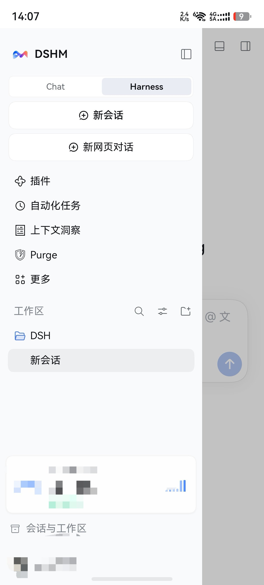
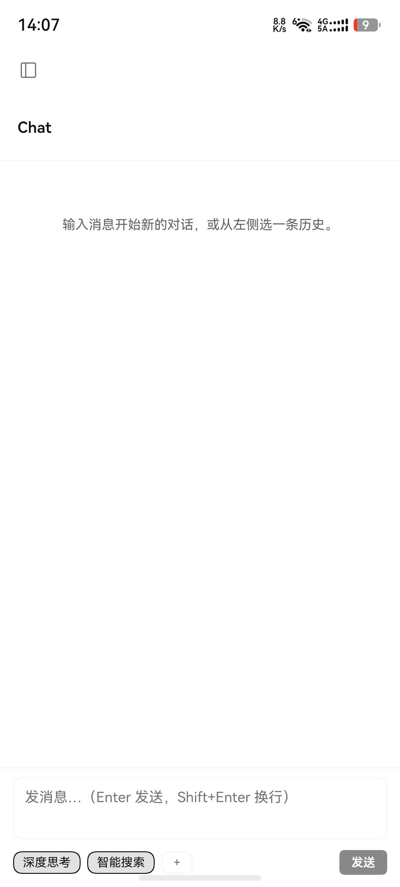
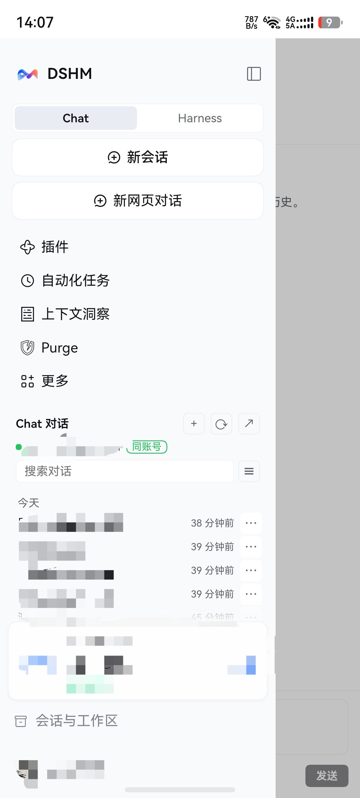

# dsh-chat-switch

> 仓库 / Repository: <https://github.com/Muhan-Q/dsh-chat-switch>
>
> **运行环境 / Tested on**
>
> - ✅ **已验证**：华为鸿蒙系统手机上的 **DSHM**（DeepSeek Harness 端侧应用，Host `0.2.2-rc.5+dshm.1`，ArkWeb WebView 内核）。
> - ⚠️ **未验证**：Windows 版 DSH、macOS / Linux 桌面版 DSH，以及其他系统（Android / iOS）的手机版 dsh —— 均未在任何一台设备上实测。
>
> 插件按「Host 只做 HTTP 转发 + 页面内算工作量证明 + 不依赖原生模块」的方式实现，理论上跨平台可用；但 UI 槽位、抽屉行为与 PoW 的 WebAssembly 执行都只在上面那台鸿蒙手机上跑通过，其它平台请自行验证。


在 DSH 主界面左侧栏顶部加一个 **Chat ⇄ Harness** 切换器：

- **Harness**（默认）：原样使用工作区 / 会话浏览区，一切照旧。
- **Chat**：左侧栏原本的工作区位置被 **chat.deepseek.com 的对话目录**接管，主列显示选中对话的完整消息（含 thinking 折叠）。点右上「在网页版打开」可跳到网页继续聊。

登录态复用同一个 DeepSeek 账号：一次把 chat.deepseek.com 的 `userToken` 交给插件，Host 侧保存（0600），之后所有目录 / 消息请求都由 Host 代发，浏览器端不受 CORS 限制，token 也不会回传到页面。

## 截图

| Harness（未切换）左侧栏 | Chat 模式主视图 | Chat 模式左侧栏 |
| --- | --- | --- |
|  |  |  |

> 三张图都截自同一台鸿蒙手机（DSHM）：切到 Chat 后，左侧栏的工作区位置被 chat.deepseek.com 的对话目录取代，主列变成可对话的聊天界面；切回 Harness 则恢复原样。

## 结构

```
dsh-chat-switch/
├── package.json          # dsh.client 声明 + exports["./client"]
├── cordis.patch.yml      # profile 里要插入的那一行
├── install.sh            # 装进 DSHM 端侧 profile
├── lib/index.js          # Host：/chat-switch/api/* 代理 chat.deepseek.com
├── lib/client.js         # Client：切换器 + 对话目录 + 消息阅读器（window.__ModuleLoader__ 形态）
├── src/smoke-host.mjs    # Host 半冒烟测试（真网络）
└── docs/notes-chat-api.md# 网页端接口记录（端点 / 头 / 响应字段）
```

## 安装

### 从 npm 安装（推荐，任何设备都能用）

DSHM → **设置 → 插件 → 添加插件** → 输入 `dsh-chat-switch` → 安装 → 重启 DSHM。

命令行等价：

```sh
pnpm add dsh-chat-switch
```

npm 地址：<https://www.npmjs.com/package/dsh-chat-switch>

### 从 GitHub 安装

在「添加插件」里填完整形式（换掉裸包名就能绕过 npm 未索引的问题）：

```
github.com/Muhan-Q/dsh-chat-switch#v0.2.0
```

### 本地目录安装（开发用）


```sh
sh install.sh
```

DSHM 每次启动都会用「种子 bundle + 用户行」**重拼** `profiles/ondevice/cordis.patch.yml`，所以手写在那里的 mount 行会在下次启动被丢掉。持久通道是 profile 自己的 `package.json`：

1. 包复制到 `$DSH_HOME/profiles/ondevice/node_modules/dsh-chat-switch`；
2. `package.json` 的 `dsh.profile.bundles` 末尾追加 `dsh-chat-switch`（包内已声明 `dsh.bundle.patch: ./cordis.patch.yml`，boot 时按 bundles 顺序合并这一层）。

不写 `dependencies`：这是本地包，写版本号会让 pnpm reconcile 去 npm 拉取。

装完必须**重启 DSHM**（`dsh.profile.patchReload: startup`），再刷新页面。切换器出现在品牌行（DSHM 图标）与「新会话」按钮之间；窄态（rail）不渲染切换器，展开侧栏即可切换，或从 Chat 视图头部点 Harness 返回。

## 使用

1. 点侧栏顶部 **Chat**。
2. 首次会显示登录卡片：点「打开 chat.deepseek.com」用与 Harness 相同的 DeepSeek 账号登录 → F12 → Application → Local Storage → 选中 `https://chat.deepseek.com` → 复制 `userToken` → 粘贴回卡片保存。Host 会用 `GET /api/v0/users/current` 校验后才落盘。
3. 目录出现后点任意一条对话，主列读取 `GET /api/v0/chat/history_messages?chat_session_id=…` 并渲染。
4. 点 **Harness** 回到原工作区界面；工作区槽位原样恢复（Chat 模式期间才临时接管 `sidebar.workspaces`）。

账号比对：状态行在 chat 账号与 Harness 账号 userId 一致时显示「同账号」徽标；账号体系不同（platform 与 chat 的 id 空间不同）时显示「Harness 账号未比对」，不影响使用。

## 设计要点

- **槽位**：切换器注册为 `sidebar.session.action`（HOC，包住「新会话」按钮并在其上方插入一行）；Chat 视图注册为 `main` 的 keyed 面板 `key: 'chat'`；对话目录在 Chat 模式下注册 `sidebar.workspaces`（抢占 ui-workspace 的浏览器区），切回 Harness 时注销该注册，原浏览器自动回来。
- **零第三方依赖**：客户端只 `require('react')`（Shell 内置种子模块），样式用 `--dsw-alias-*` 主题变量内联注入；Host 只用 Node 内置模块，服务通过 `ctx.get()` 取，不 import DSH 包，便于在端侧任何 profile 里加载。
- **接口**（Host 侧）：

| 方法 | 路径 | 作用 |
| --- | --- | --- |
| GET | `/chat-switch/api/status` | 登录态、chat 用户、Harness 账号比对信息（不含 token） |
| POST | `/chat-switch/api/token` | 校验并保存 `userToken` |
| POST | `/chat-switch/api/logout` | 清除本地 token |
| GET | `/chat-switch/api/sessions` | 对话目录（分页参数透传） |
| GET | `/chat-switch/api/messages` | 单会话消息 |
| POST | `/chat-switch/api/session/create` | 新建一条 chat 对话 |
| POST | `/chat-switch/api/pow/challenge` | 取 DeepSeekHashV1 工作量证明挑战 |
| POST | `/chat-switch/api/chat/send` | 发送消息并把上游 SSE 原样转发给页面 |
| POST | `/chat-switch/api/file/upload` | 上传文件（multipart + 独立 PoW），返回 file id |
| POST | `/chat-switch/api/session/title` / `pinned` / `delete` | 重命名 / 置顶 / 删除 |
| GET | `/chat-switch/api/probe` | 连通性与端点自检 |

- 只接受本机（`127.0.0.1`/`::1`）请求，响应 `cache-control: no-store`。

## 已知边界

- chat.deepseek.com 的网页接口不是公开契约，站点改版可能让目录或消息读取失败；失败会在侧栏红框里原样给出服务端消息，不会静默。
- `userToken` 与 Harness 的账号 grant（`api.deepseek.com` 用）是两套 token，不能互换；插件用「同一账号登录一次」的方式满足同账号，而不是复用 Harness 的 grant。
- 发送与上传都要过 `DeepSeekHashV1` 工作量证明（difficulty 144000，单次约 10–25 秒）。Host 进程是 `--jitless`，跑不了 WebAssembly，所以 wasm 求解放在页面里：插件内嵌 chat 自家的 `sha3_wasm_bg.wasm`（26KB，base64），不发起跨域请求。
- 重启后若侧栏没有出现切换器，检查 DSHM 启动日志里 `chat-switch` 行与 `/chat-switch/api/status` 是否可达。

## 卸载

从 profile 的 `cordis.patch.yml` 删掉那条 `insert`，并删除 `profiles/ondevice/node_modules/dsh-chat-switch`，重启 DSHM。
