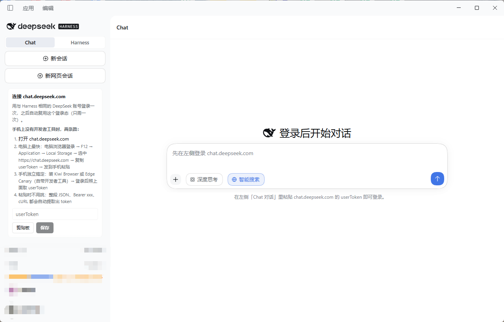
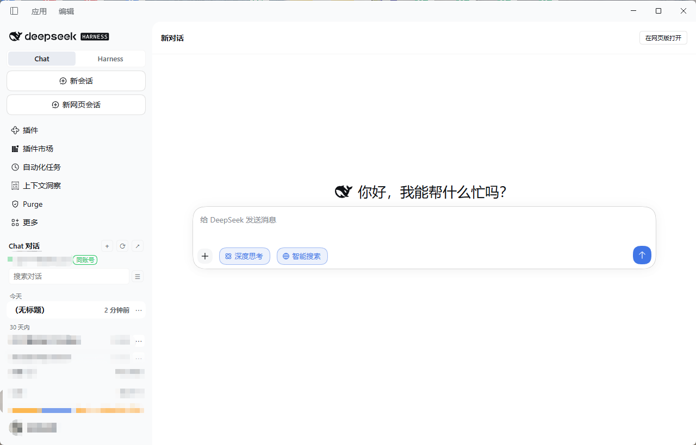

# dsh-chat-switch

> 仓库 / Repository: <https://github.com/Muhan-Q/dsh-chat-switch> · npm: <https://www.npmjs.com/package/dsh-chat-switch>
>
> **运行环境 / Platforms**：桌面版 DSH（Windows / macOS / Linux，含 DSH 桌面客户端与浏览器里的 Web GUI）与手机端 DSHM 均可直接使用。
>
> 插件按「Host 只做 HTTP 转发 + 页面内算工作量证明 + 不依赖原生模块」的方式实现：Host 半只用 Node 内置模块，客户端半只 `require('react')` 并使用 Shell 的公开槽位，因此同一份代码在任何面向前端的 DSH profile 里行为一致。


在 DSH 主界面左侧栏顶部加一个 **Chat ⇄ Harness** 切换器：

- **Harness**（默认）：原样使用工作区 / 会话浏览区，一切照旧。
- **Chat**：左侧栏原本的工作区位置被 **chat.deepseek.com 的对话目录**接管，主列显示选中对话的完整消息（含 thinking 折叠）。点右上「在网页版打开」可跳到网页继续聊。

登录态复用同一个 DeepSeek 账号：一次把 chat.deepseek.com 的 `userToken` 交给插件，Host 侧保存（0600），之后所有目录 / 消息请求都由 Host 代发，浏览器端不受 CORS 限制，token 也不会回传到页面。

## 截图

| 刚安装、尚未登录 chat.deepseek.com | 登录之后的 Chat 主视图 |
| --- | --- |
|  |  |

`docs/preview.html` 是脱离 DSH 的版式预览（同一套 CSS + 真实图标内联），改样式时直接打开对照。

> 切到 Chat 后，左侧栏的工作区位置被 chat.deepseek.com 的对话目录取代，主列变成可对话的聊天界面；切回 Harness 则恢复原样。

## 结构

```
dsh-chat-switch/
├── package.json          # dsh.client 声明 + exports["./client"]
├── cordis.patch.yml      # profile 里要插入的那一行
├── install.sh            # 装进 DSHM 端侧 profile
├── lib/index.js          # Host：/chat-switch/api/* 代理 chat.deepseek.com
├── lib/client.js         # Client：切换器 + 对话目录 + 消息阅读器（window.__ModuleLoader__ 形态）
├── src/smoke-host.mjs    # Host 半冒烟测试（真网络）
└── docs/notes-chat-api.md# 网页端接口记录（端点 / 头 / 响应字段）
```

## 安装

### 从 npm 安装（推荐，任何设备都能用）

DSHM → **设置 → 插件 → 添加插件** → 输入 `dsh-chat-switch` → 安装 → 重启 DSHM；桌面版用 `dsh plugin add dsh-chat-switch --profile <profile>`。

命令行等价：

```sh
pnpm add dsh-chat-switch
```

npm 地址：<https://www.npmjs.com/package/dsh-chat-switch>

### 从 GitHub 安装

在「添加插件」里填完整形式（换掉裸包名就能绕过 npm 未索引的问题）：

```
github.com/Muhan-Q/dsh-chat-switch#v0.2.5
```

### 本地目录安装（开发用）


```sh
sh install.sh
```

DSHM 每次启动都会用「种子 bundle + 用户行」**重拼** `profiles/ondevice/cordis.patch.yml`，所以手写在那里的 mount 行会在下次启动被丢掉。持久通道是 profile 自己的 `package.json`：

1. 包复制到 `$DSH_HOME/profiles/ondevice/node_modules/dsh-chat-switch`；
2. `package.json` 的 `dsh.profile.bundles` 末尾追加 `dsh-chat-switch`（包内已声明 `dsh.bundle.patch: ./cordis.patch.yml`，boot 时按 bundles 顺序合并这一层）。

不写 `dependencies`：这是本地包，写版本号会让 pnpm reconcile 去 npm 拉取。

装完必须**重启 DSHM**（`dsh.profile.patchReload: startup`），再刷新页面。侧栏顶部自上而下依次是：品牌行 → **Chat / Harness 切换器** → 原生「新会话」→「**新网页会话**」（在 Chat 模式新建一条 chat.deepseek.com 对话）。窄态（rail）不渲染切换器，展开侧栏即可切换，或从 Chat 视图头部点 Harness 返回。

## 使用

1. 点侧栏顶部 **Chat**。
2. 首次会显示登录卡片：点「打开 chat.deepseek.com」用与 Harness 相同的 DeepSeek 账号登录 → F12 → Application → Local Storage → 选中 `https://chat.deepseek.com` → 复制 `userToken` → 粘贴回卡片保存。Host 会用 `GET /api/v0/users/current` 校验后才落盘。
3. 目录出现后点任意一条对话，主列读取 `GET /api/v0/chat/history_messages?chat_session_id=…` 并渲染。
4. 点 **Harness** 回到原工作区界面；工作区槽位原样恢复（Chat 模式期间才临时接管 `sidebar.workspaces`）。
5. 在 Chat 模式下点原生「新会话」：模式先回到 Harness（工作区浏览器立刻回来、切换器跟着跳到 Harness），再打开那条新会话——新建的是 Harness 会话，不会被留在 Chat 目录里。

账号比对：状态行在 chat 账号与 Harness 账号 userId 一致时显示「同账号」徽标；账号体系不同（platform 与 chat 的 id 空间不同）时显示「Harness 账号未比对」，不影响使用。

## 设计要点

- **槽位**：切换器注册为 `sidebar.session.action`（HOC，包住「新会话」按钮并在其上方插入切换器、其下方插入「新网页会话」）；Chat 视图注册为 `main` 的 keyed 面板 `key: 'chat'`；对话目录在 Chat 模式下注册 `sidebar.workspaces`（抢占 ui-workspace 的浏览器区），切回 Harness 时注销该注册，原浏览器自动回来。
- **模式跟随新会话**：`document` 的捕获阶段监听点击，命中 shell 自己的「新会话」按钮（按 `aria-label` 认，含 locale 取值）时先切回 Harness，再由 shell 打开会话——所以工作区与切换器不会停在 Chat。
- **网页版版式**：Chat 主视图照 chat.deepseek.com 的布局重写——空态是「官方鲸鱼 logo + 你好，我能帮什么忙吗？」加一张居中圆角输入卡片；对话态是 760px 居中窄栏，用户消息靠右浅底气泡、助手消息无底色平铺，输入卡片固定在底部。卡片内部按网页版排布：无边框输入区在上，左下是 上传 / 深度思考 / 智能搜索，右下是蓝底白 ↑ 发送（生成中变红停止）。
- **图标与排版来源**：logo、发送、上传、深度思考、智能搜索的图形直接取自 DSH 自己的图标表（`FISH_LOGO_PATH` 与 `send-outline` / `paperclip-outline` / `plus-outline` / `think-outline` / `globe-outline` / `stop-fill`），内联成 SVG，不自己画、不带第三方图标包；字号、行高、圆角、按钮盒模型一律走 DSH 的 `--dsh-content-font-size`、`--dsw-radius-*`、`--dsw-alias-*` token，与 Harness 本体一致。
- **回答脚注**：助手消息下方先是「内容由 AI 生成，请仔细甄别」，再是「（站点 favicon ×3）N 个网页」胶囊，展开是来源列表（来自上游 `TOOL_SEARCH` 的 `results`，去重上限 20 条），和网页版一致；上游塞进正文的「搜索到 N 个网页」这类工具头会被过滤掉，不会跑到回答最前面。
- **回答操作行**：每条回答下方一排网页版同款图标（图标取自 DSH 图标表 `copy-outline` / `refresh-outline` / `play-outline` / `share-outline`）。行为：**复制**写入剪贴板；**重新生成**丢掉这条回答、用同一条提问重发；**朗读**走浏览器 `speechSynthesis`（再点一次停止）；**分享**复制该会话的 `chat.deepseek.com` 链接。点赞/点踩未做——上游没有反馈接口，纯本地状态没有实际作用。
- **附件**：拖拽文件到主列即可添加（遮罩与网页版同文案），也支持卡片左下「＋」选择文件；限制对齐网页版——单文件 100MB、一次最多 50 个。文本类附件（md / txt / json / csv / 代码）与 Word 文档（.docx）上传时会缓存在 Host 内存里；点输入框里或消息里的附件胶囊，会在 **Chat 主视图右侧停靠一个只读阅读器**（不遮住对话，关掉即恢复原宽）。Markdown 与 docx 按格式排版（标题、列表、加粗、引用），普通文本原样折行；全程只读，缓存上限 8MB / 32 条。
- **面板跟随**：从插件页、插件市场等任何面板点「新网页会话」或会话列表，都会先把主面板切回 Chat，再打开对应对话。
- **零第三方依赖**：客户端只 `require('react')`（Shell 内置种子模块），样式用 `--dsw-alias-*` 主题变量内联注入；Host 只用 Node 内置模块，服务通过 `ctx.get()` 取，不 import DSH 包，便于在端侧任何 profile 里加载。
- **接口**（Host 侧）：

| 方法 | 路径 | 作用 |
| --- | --- | --- |
| GET | `/chat-switch/api/status` | 登录态、chat 用户、Harness 账号比对信息（不含 token） |
| POST | `/chat-switch/api/token` | 校验并保存 `userToken` |
| POST | `/chat-switch/api/logout` | 清除本地 token |
| GET | `/chat-switch/api/sessions` | 对话目录（分页参数透传） |
| GET | `/chat-switch/api/messages` | 单会话消息 |
| POST | `/chat-switch/api/session/create` | 新建一条 chat 对话 |
| POST | `/chat-switch/api/pow/challenge` | 取 DeepSeekHashV1 工作量证明挑战 |
| POST | `/chat-switch/api/chat/send` | 发送消息并把上游 SSE 原样转发给页面 |
| POST | `/chat-switch/api/file/upload` | 上传文件（multipart + 独立 PoW），返回 file id |
| POST | `/chat-switch/api/session/title` / `pinned` / `delete` | 重命名 / 置顶 / 删除 |
| GET | `/chat-switch/api/probe` | 连通性与端点自检 |

- 只接受本机（`127.0.0.1`/`::1`）请求，响应 `cache-control: no-store`。

## 已知边界

- chat.deepseek.com 的网页接口不是公开契约，站点改版可能让目录或消息读取失败；失败会在侧栏红框里原样给出服务端消息，不会静默。
- `userToken` 与 Harness 的账号 grant（`api.deepseek.com` 用）是两套 token，不能互换；插件用「同一账号登录一次」的方式满足同账号，而不是复用 Harness 的 grant。
- 发送与上传都要过 `DeepSeekHashV1` 工作量证明（difficulty 144000，单次约 10–25 秒）。Host 进程是 `--jitless`，跑不了 WebAssembly，所以 wasm 求解放在页面里：插件内嵌 chat 自家的 `sha3_wasm_bg.wasm`（26KB，base64），不发起跨域请求。
- 阅读器是 Chat 面板内的停靠列，没有复用 DSH 的右侧栏：那个服务按会话作用域提供，Chat 模式下没有归属会话，调用会静默落空。
- docx 的排版来自 `word/document.xml` 的段落样式（`outlineLvl` / 标题样式 / 编号），Word 里的浮动图片、表格合并单元格、页眉页脚不会显示。
- 文本附件的预览正文存在 Host 内存（8MB / 32 条），重启 DSH 后旧链接失效，点开会提示重新上传；上传时每份文件仍要过一次工作量证明，所以单文件会有 10–20 秒等待，卡片里会显示「正在计算工作量证明…」。
- 重启后若侧栏没有出现切换器，检查 DSH 启动日志里 `chat-switch` 行与 `/chat-switch/api/status` 是否可达。
- 「新会话」的**键盘快捷键**由 Shell 直接走导航，不经过点击；用快捷键新建时模式不会自动跟随，点一下切换器即可回到 Harness。
- 图标是 DSH 图标表里的原始路径，改名或重构 DSH 图标表时这里会跟着失效；`docs/preview.html` 是脱离 DSH 的版式预览，调样式时直接打开对照。

## 卸载

桌面版：`dsh plugin remove dsh-chat-switch --profile <profile>` 后重启。端侧：从 profile 的 `cordis.patch.yml` 删掉那条 `insert`，并删除 `profiles/ondevice/node_modules/dsh-chat-switch`，重启 DSHM。
